<div align="center">


### A moments-first celebration planner for weddings, birthdays and community events

<br/>


**Built for PromptWars Virtual · Challenge 5: Celebration & Event Planner**

[Problem](#-the-problem) ·
[Features](#-signature-features) ·
[Architecture](#-system-architecture) ·
[Connectivity](#-connectivity-how-everything-talks) ·
[API](#-api-reference) ·
[Structure](#-project-structure) ·
[Run Locally](#-run-locally)

<br/>

> *"What do our guests actually lose if we cut this?"*

<br/>

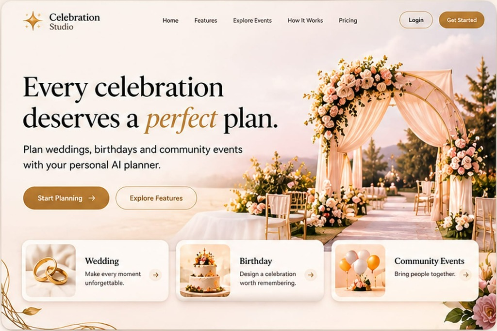

</div>

---

## 📑 Table of Contents

1. [The Problem](#-the-problem)
2. [What KSHAN Does](#-what-kshan-does)
3. [Product Tour (Screenshots)](#-product-tour)
4. [Signature Features](#-signature-features)
5. [User Journey](#-user-journey)
6. [System Architecture](#-system-architecture)
7. [Connectivity: How Everything Talks](#-connectivity-how-everything-talks)
8. [Frontend](#-frontend)
9. [API Reference](#-api-reference)
10. [AI vs. Code: Who Does What](#-ai-vs-code-who-does-what)
11. [The Deterministic Engine](#-the-deterministic-engine)
12. [Project Structure](#-project-structure)
13. [Tech Stack](#-tech-stack)
14. [Security & Privacy](#-security--privacy)
15. [Accessibility](#-accessibility-wcag-21-aa)
16. [Testing](#-testing)
17. [Run Locally](#-run-locally)
18. [Deploy to Vercel](#-deploy-to-vercel)
19. [Known Boundaries](#-known-boundaries)
20. [Build Process](#-build-process)
21. [License](#-license)

---

## 💔 The Problem

Most event planning software treats a celebration as an **accounts-payable ledger**: a list of vendors, line-item invoices, and detached to-do checklists.

When money or time runs short, a vendor-centric view cannot answer the only question that matters to the host:

> **"What do our guests actually lose if we cut this?"**

Couples and families end up overspending on invisible logistical overhead while their most cherished signature moments get squeezed.

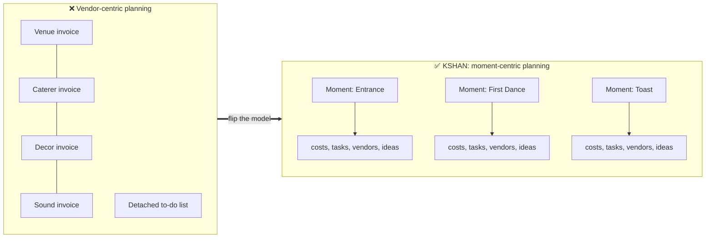

---

## 🌟 What KSHAN Does

KSHAN flips celebration planning on its head: **you plan and budget the 5 to 9 signature moments that define your celebration.** Every cost, task, vendor brief and creative idea attaches directly to those moments.

| Challenge Requirement | How KSHAN Delivers It |
|---|---|
| 💰 **Budgets** | **Moment Budget.** Allocates money by moment importance and guest impact, attributes shared costs (venue, sound, decor) across moments, and computes cost per moment and per guest. Protects a strict 10% contingency. Integer paise math with largest-remainder reconciliation. |
| 📅 **Timelines** | **Backwards Timeline.** Every task is tied to a moment and counted backwards from the event date. Dependency DAGs, cycle detection, delay propagation, and automatic lead-time compression when the event is imminent. |
| ✅ **Vendor Checklists** | **One-Page Cue Sheets.** A printable brief per vendor containing only the moments they serve, exact start and end times (24h/12h), cue triggers and contract questions. |
| ✨ **Personalised Ideas** | **Story Interview.** A 5-question host interview parsed into structured moments and 3-tier creative suggestions (modest, balanced, lavish) with integer paise estimate bands. |
| 🤖 **GenAI Assistant** | **Review Card pattern.** Gemini proposes; deterministic code validates and stages; the user decides with **Apply**, **Edit** or **Dismiss**. Runs fully offline via a rule-based fallback. |
| 🎊 **Weddings, Birthdays, Community Events** | **Three built-in templates** with tailored starter moments, cost structures, backwards tasks and vendor questions. |

---

## 📸 Product Tour

A warm, editorial interface: cream surfaces, bronze-gold accents, serif headlines and soft rounded cards, designed to feel like a celebration rather than a spreadsheet.

<div align="center">

### 🏠 Landing Page
*Three entry points (Wedding, Birthday, Community Events) and a clear call to start planning.*


<br/><br/>

### 📊 Dashboard
*Your celebration at a glance: countdown, total budget, spend so far, guest count, task progress, upcoming tasks and quick actions.*

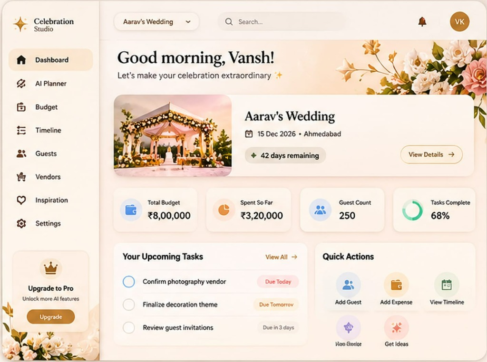

<br/><br/>

### 🤖 AI Planner &nbsp;·&nbsp; 💰 Budget Overview

<table width="100%">
<tr>
<td width="58%" align="center" valign="top">
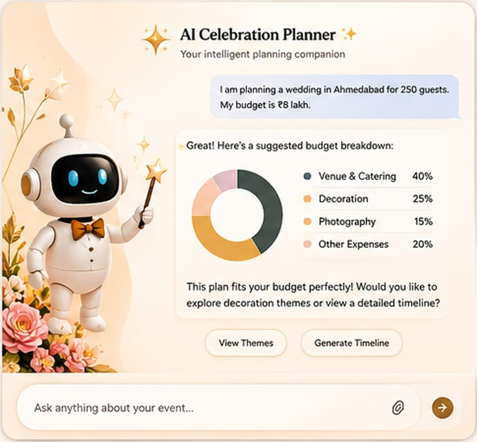<br/>
<sub><b>AI Celebration Planner.</b> Describe the event in plain words and get a suggested budget split, with follow-up actions like View Themes and Generate Timeline.</sub>
</td>
<td width="42%" align="center" valign="top">
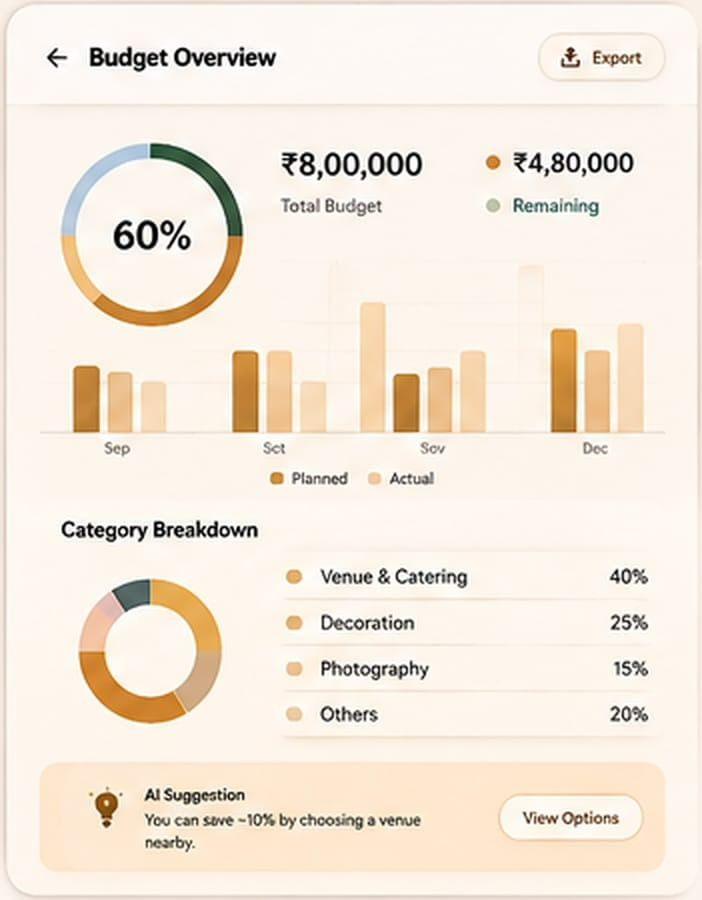<br/>
<sub><b>Budget Overview.</b> Budget used, planned vs. actual by month, category breakdown, an AI saving suggestion and one-tap export.</sub>
</td>
</tr>
</table>

<br/>

### 🏛 Vendors &nbsp;·&nbsp; 📱 Mobile

<table width="100%">
<tr>
<td width="61%" align="center" valign="top">
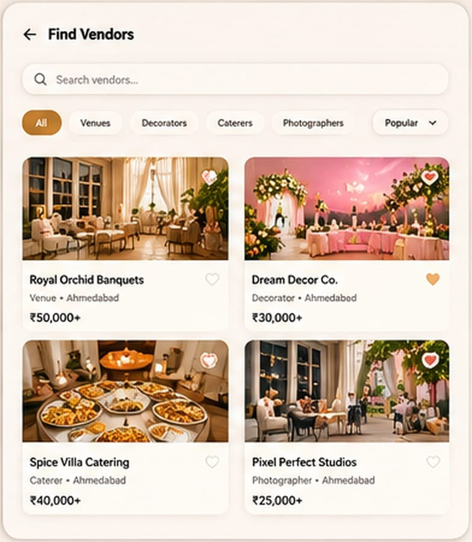<br/>
<sub><b>Find Vendors.</b> Search and filter venues, decorators, caterers and photographers, with starting prices and favourites.</sub>
</td>
<td width="39%" align="center" valign="top">
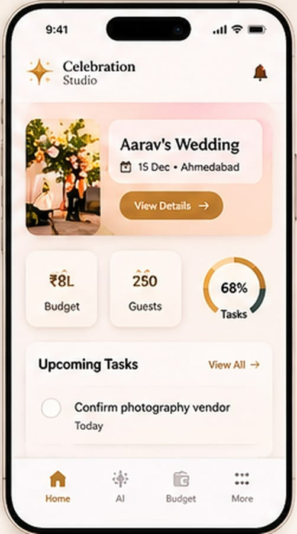<br/>
<sub><b>Mobile.</b> The same dashboard in your pocket, with bottom navigation for Home, AI, Budget and More.</sub>
</td>
</tr>
</table>

</div>

### 🧩 Screens at a glance

| Screen | What you see | Shot |
|---|---|---|
| 🏠 **Landing** | Hero, occasion cards, Start Planning | [01](docs/screenshots/01-landing.jpg) |
| 📊 **Dashboard** | Countdown, KPIs, upcoming tasks, quick actions, sidebar navigation | [02](docs/screenshots/02-dashboard.jpg) |
| 🤖 **AI Planner** | Chat that returns a budget breakdown and next-step chips | [03](docs/screenshots/03-ai-planner.jpg) |
| 💰 **Budget Overview** | Progress ring, planned vs. actual bars, categories, AI tip | [04](docs/screenshots/04-budget-overview.jpg) |
| 🏛 **Find Vendors** | Search, category filters, vendor cards | [05](docs/screenshots/05-find-vendors.jpg) |
| 📱 **Mobile Home** | Compact dashboard with bottom tab bar | [06](docs/screenshots/06-mobile-home.jpg) |

### 🎨 Design Language

| | Token | Used for |
|---|---|---|
|  | **Bronze gold** `#B5762A` | Primary buttons, active navigation, key numbers |
|  | **Soft amber** `#E8B96A` | Charts, highlights, progress |
|  | **Blush peach** `#F3CFB5` | Gradients, floral accents |
|  | **Warm cream** `#FDF3EA` | Page and card surfaces |
|  | **Forest green** `#2F4A3A` | Positive status, remaining budget |

*Colours are approximated from the screenshots; replace with your exact design tokens if they differ.*

---

## 🚀 Signature Features

<table>
<tr>
<td width="50%" valign="top">

### 🃏 The Moment Deck
Select, sequence and tune your celebration's signature moments. Set host importance (1–5), target energy (1–5) and guest impact multipliers, and **lock** the must-haves.

</td>
<td width="50%" valign="top">

### ⚖️ Trade-Off Simulator
Simulate **cutting or upgrading** a moment before committing. Preview freed funds, redistributed budgets, removed tasks and vendor impacts in real time.

</td>
</tr>
<tr>
<td valign="top">

### 📈 The Energy Curve
Visualise the emotional arc of the day. Flags awkward lulls (over 45 min of low energy), rushed transitions (under 15 min of high delta), unsupported peaks and overlong intense segments. Includes a fully accessible **tabular equivalent**.

</td>
<td valign="top">

### 🗒️ Vendor Cue Sheets
Print-ready, one-page briefs per vendor so every collaborator knows their exact **cue and trigger** on event day.

</td>
</tr>
<tr>
<td valign="top">

### 📖 The Moment Book
A complete, printable celebration guide (`@media print`) with schedule, master budget, vendor cue sheets and backwards timeline.

</td>
<td valign="top">

### 📝 After-Event Log
A post-celebration reality scorecard: record actual spend, calculate net variance against planned allocations, rate moments **Keep** or **Skip**, and preserve learnings for next time.

</td>
</tr>
</table>

---

## 🧭 User Journey

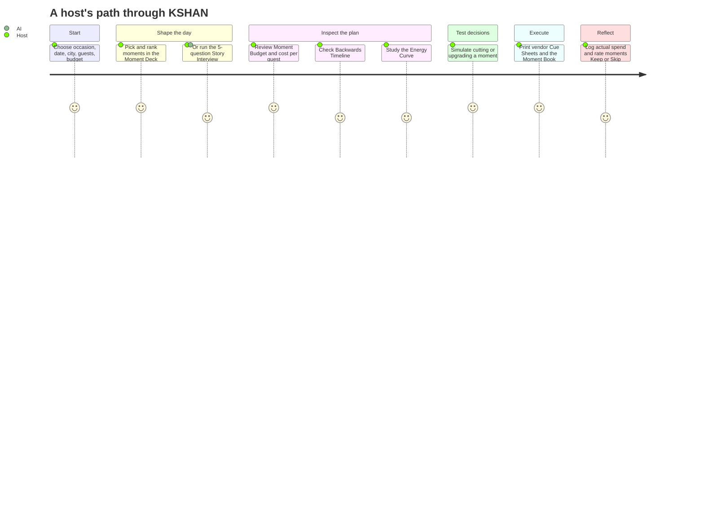

```text
1. Select Celebration ──► occasion (Wedding, Birthday, Community), date, city, guests, budget
2. Build the Moment Deck ──► pick and rank moments, or run the Story Interview
3. Inspect Plan Workspace ──► Moment Budget · Backwards Timeline · Vendor Cue Sheets
4. Test Trade-Offs ──► simulate cuts and upgrades, balance funds, remove feasibility gaps
5. Print & Distribute ──► export JSON/CSV, print per-vendor Cue Sheets and the Moment Book
6. After-Event Debrief ──► actual spend per moment, net variance, Keep or Skip ratings
```

---

## 🏗 System Architecture

KSHAN is a **local-first single-page app** with a thin **serverless AI layer**. Plans never leave the browser; the server exists only to keep the Gemini key private and to guard AI calls.

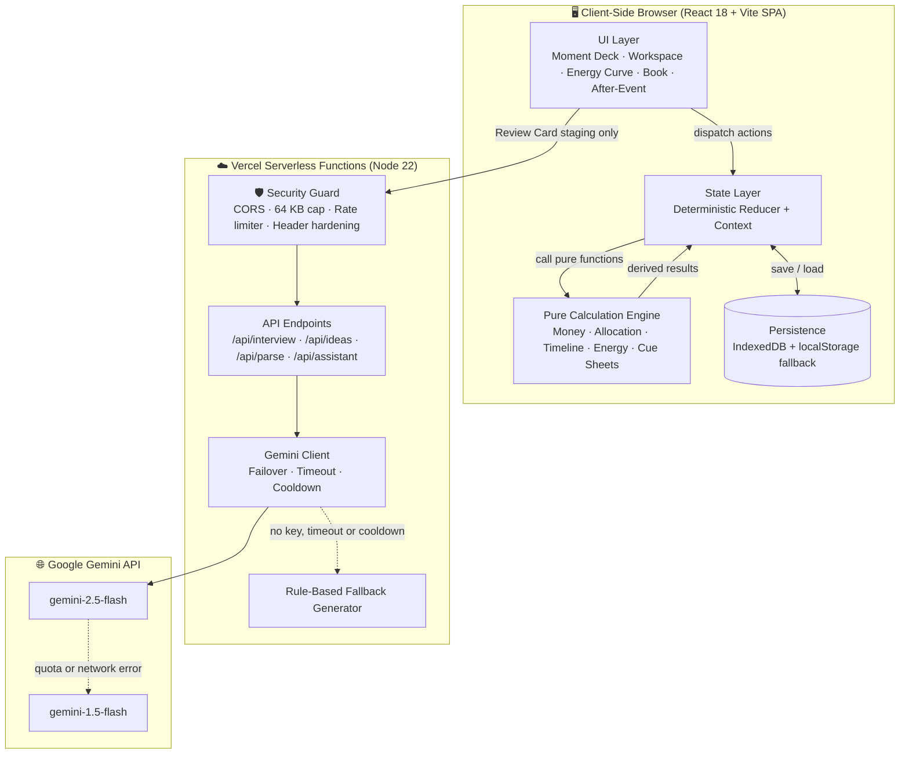

### Design principles

| Principle | What it means in KSHAN |
|---|---|
| 🏠 **Local-first** | No database, no accounts. The plan lives in IndexedDB, so there is no remote store to breach. |
| 🧮 **Deterministic core** | All money, allocation and scheduling is plain tested code. AI never does arithmetic. |
| 🧑‍⚖️ **Human in the loop** | AI output becomes a *Review Card*. Nothing changes the plan until the user clicks Apply. |
| 🔌 **Graceful degradation** | Without a key, offline, or in cooldown, the rule-based fallback keeps every feature working. |
| 🔐 **Server-only secrets** | `GEMINI_API_KEY` exists only in the serverless environment, never in the browser bundle. |

---

## 🔌 Connectivity: How Everything Talks

### 1. A request from click to Review Card

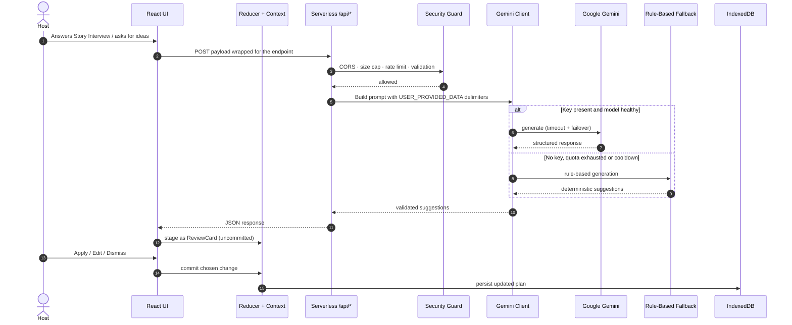

### 2. Gemini failover chain

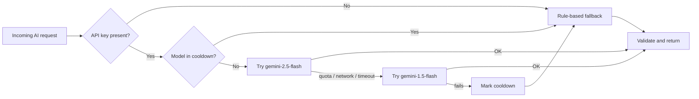

### 3. Who owns what data

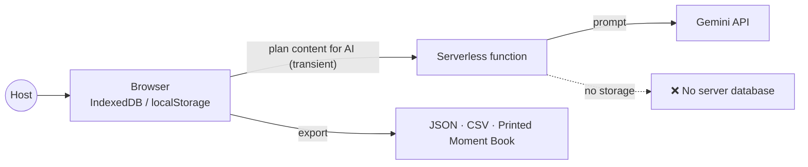

---

## 🎨 Frontend

A **React 18 + TypeScript + Vite** single-page app. State changes flow through one deterministic reducer, and every derived number comes from the pure engine.

### Screens

| Screen | Purpose | Key interactions |
|---|---|---|
| 🏠 **Landing** | Explains the moments-first idea and starts a plan | Choose occasion, date, city, guests, budget |
| 🃏 **Moment Deck** | Choose and tune the 5–9 signature moments | Rank, importance, energy, impact, lock |
| 🧮 **Plan Workspace** | The control room for budget, timeline and vendors | Moment Budget, Backwards Timeline, Cue Sheets |
| ⚖️ **Trade-Off Simulator** | Safe what-if testing | Cut or upgrade, preview, then commit |
| 📈 **Energy Curve** | Emotional arc of the day | Chart plus accessible table, flag badges |
| 🎤 **Story Interview** | 5 questions turned into moments | AI parse, Review Cards |
| 📖 **Moment Book** | Printable full guide | `@media print` layout |
| 📝 **After-Event Log** | Reality check and learnings | Actual spend, variance, Keep or Skip |

### Frontend data flow

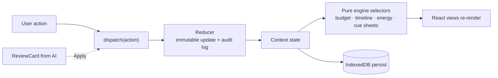

---

## 📡 API Reference

All AI features go through four serverless endpoints. The browser never talks to Gemini directly.

| Endpoint | Purpose | Typical caller |
|---|---|---|
| `/api/interview` | Drives the 5-question Story Interview | Story Interview screen |
| `/api/parse` | Extracts structured moments from raw, unstructured notes | Story Interview, Moment Deck |
| `/api/ideas` | Proposes 3-tier ideas (modest, balanced, lavish) with paise estimate bands | Moment Deck, Workspace |
| `/api/assistant` | Answers contextual questions about the host's celebration | Assistant panel |

### Request pipeline (every endpoint)

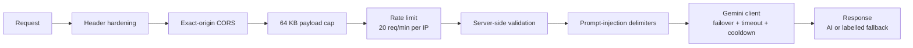

### Guarantees

- ✅ Server-side input validation on every route
- ✅ Maximum payload **64 KB**
- ✅ Sliding-window rate limit: **20 requests / minute / IP**
- ✅ User text wrapped in `<USER_PROVIDED_DATA>…</USER_PROVIDED_DATA>` with anti-override system prompts
- ✅ Every AI response is **staged as a Review Card**, never applied automatically
- ✅ Works with **no API key** through the built-in fallback

---

## 🤝 AI vs. Code: Who Does What

| 🧠 AI (language and exploration) | ⚙️ Pure deterministic code (ground truth) |
|---|---|
| Parses the host narrative from the 5-question Story Interview | All monetary calculations in integer paise (`1 INR = 100 paise`) |
| Proposes creative ideas across 3 tiers | Largest-remainder allocation guaranteeing **Σ allocated = pool** |
| Extracts structured moments from raw notes | Shared-cost attribution across moments with normalised usage weights |
| Answers contextual questions about the celebration | Backwards timeline scheduling, DAG cycle detection, compression |
| Stages suggestions as uncommitted `ReviewCard`s | Energy Curve transition analysis and flag triggers (`LULL`, `RUSHED`, …) |
| | Input validation, prototype-pollution checks, local persistence |

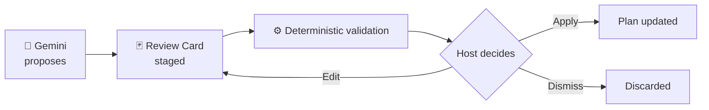

---

## ⚙️ The Deterministic Engine

The engine is pure TypeScript with no UI or network dependencies, which is why it carries the highest test coverage (**93.27% statements**).

| Module | Responsibility | Highlights |
|---|---|---|
| 💵 **Money** | Currency handling | Integer **paise** only, no floating-point drift |
| 🧮 **Allocation** | Splitting the pool across moments | **Largest-remainder** method, exact reconciliation, 10% protected contingency |
| 🔗 **Shared cost attribution** | Venue, sound, decor across moments | Normalised usage weights |
| ⚖️ **Trade-off simulation** | Cut or upgrade preview | Freed funds, redistribution, removed tasks, vendor impact |
| 📅 **Timeline** | Backwards scheduling | Dependency DAG, cycle detection, delay propagation, lead-time compression |
| 📈 **Energy** | Emotional arc analysis | Flags: `LULL`, `RUSHED`, unsupported peak, overlong intensity |
| 🗒️ **Cue sheets** | Per-vendor briefs | Only relevant moments, 24h/12h times, triggers, contract questions |
| 📦 **Export / import** | JSON and CSV | Invariant-checked round-trips, formula-injection safe |

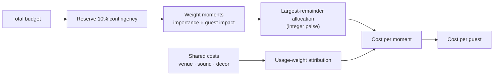

---

## 🗂 Project Structure

> Adjust folder names to match your repository if any differ.

```text
kshan/
├── 📁 api/                          # Vercel serverless functions (Node 22)
│   ├── interview.ts                 #   Story Interview driver
│   ├── parse.ts                     #   Notes → structured moments
│   ├── ideas.ts                     #   3-tier idea generation
│   ├── assistant.ts                 #   Contextual Q&A
│   └── _lib/
│       ├── guard.ts                 #   CORS · 64 KB cap · rate limit · headers
│       ├── gemini.ts                #   Client with failover, timeout, cooldown
│       ├── prompts.ts               #   Prompts with USER_PROVIDED_DATA delimiters
│       └── fallback.ts              #   Rule-based generator
│
├── 📁 src/
│   ├── 📁 components/               # React UI
│   │   ├── landing/                 #   Landing page
│   │   ├── deck/                    #   Moment Deck
│   │   ├── workspace/               #   Budget · Timeline · Cue Sheets
│   │   ├── simulator/               #   Trade-Off Simulator
│   │   ├── energy/                  #   Energy Curve + tabular equivalent
│   │   ├── interview/               #   Story Interview + Review Cards
│   │   ├── book/                    #   Moment Book (print view)
│   │   └── after-event/             #   After-Event Log
│   ├── 📁 engine/                   # Pure calculation engine (no UI, no network)
│   │   ├── money.ts                 #   Integer paise arithmetic
│   │   ├── allocation.ts            #   Largest-remainder allocation
│   │   ├── shared-costs.ts          #   Shared cost attribution
│   │   ├── tradeoff.ts              #   Cut / upgrade simulation
│   │   ├── timeline.ts              #   Backwards DAG scheduling
│   │   ├── energy.ts                #   Energy flags
│   │   ├── cue-sheets.ts            #   Vendor brief builder
│   │   └── export-import.ts         #   JSON / CSV with sanitisation
│   ├── 📁 state/                    # Reducer, context, audit log
│   ├── 📁 storage/                  # IndexedDB with localStorage fallback
│   ├── 📁 templates/                # Wedding · Birthday · Community presets
│   ├── 📁 types/                    # Shared TypeScript types
│   └── main.tsx
│
├── 📁 tests/
│   ├── unit/                        # Vitest: engine, reducer, CSV, serverless
│   └── e2e/                         # Playwright: full journey + 320 px pass
│
├── 📁 docs/
│   ├── ARCHITECTURE.md
│   ├── TESTING.md
│   ├── ACCESSIBILITY.md
│   ├── ANTIGRAVITY_BUILD_LOG.md
│   └── screenshots/                 # Images used in this README
│
├── .env.example                     # GEMINI_API_KEY template
├── vercel.json                      # Routing and headers
├── vite.config.ts
├── package.json
└── README.md
```

### How the layers depend on each other

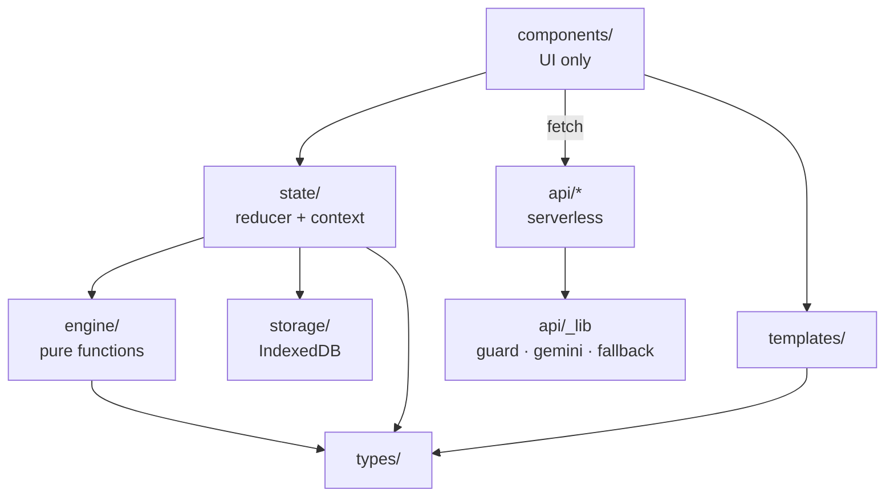

> **Rule:** `engine/` never imports from `components/`, `state/` or `api/`. That keeps the math testable and trustworthy.

---

## 🧰 Tech Stack

| Layer | Technology | Why |
|---|---|---|
| 🎨 **Frontend** | React 18, TypeScript (strict), Vite | Fast SPA, type-safe UI |
| 🧠 **State** | Deterministic reducer + React Context | Predictable, auditable changes |
| ⚙️ **Engine** | Pure TypeScript functions | Testable, no side effects |
| 💾 **Storage** | IndexedDB, localStorage fallback | Local-first privacy |
| ☁️ **Backend** | Vercel Serverless Functions, Node 22 | Hides the API key, no servers to run |
| 🤖 **AI** | Google Gemini (`gemini-2.5-flash`, failover `gemini-1.5-flash`) | Creative parsing and ideas |
| 🧪 **Testing** | Vitest, Playwright, axe | Unit, end-to-end and accessibility |
| 🧹 **Quality** | ESLint (zero warnings), `tsc --noEmit` | Clean, strict codebase |

---

## 🔐 Security & Privacy

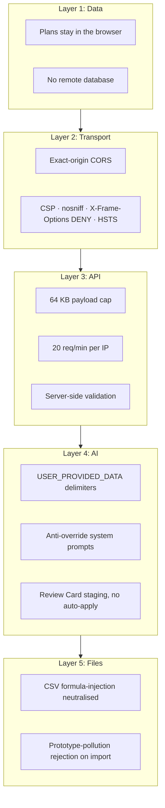

| Threat | Defence |
|---|---|
| 🕵️ **Personal data exposure** | Zero-storage privacy: plans live only in IndexedDB or localStorage |
| 🔑 **API key leakage** | Key is read only in serverless functions, never bundled |
| 🌊 **Abuse / flooding** | Sliding-window limit (20 req/min/IP) and 64 KB cap |
| 💉 **Prompt injection** | Delimited user data and anti-override system prompts |
| 📊 **CSV formula injection** | Cells starting with `=`, `+`, `-`, `@`, tab or carriage return are neutralised |
| 🧬 **Prototype pollution** | Imports containing `__proto__`, `constructor` or `prototype` keys are rejected before schema validation |
| 🌐 **Cross-origin abuse** | Exact-origin CORS and hardened HTTP headers |

---

## ♿ Accessibility (WCAG 2.1 AA)

| Area | Implementation |
|---|---|
| 🧱 **Landmarks** | Single `<main id="main-content">` per view and a visible skip-to-content link |
| 📊 **Accessible charts** | The Energy Curve SVG ships with a full **tabular equivalent** for screen readers |
| 🎨 **Colour independence** | Badges use text, icons and high-contrast colour together |
| 🔍 **Contrast** | Body text above 4.5:1, large headings above 3:1 |
| 📱 **Responsive** | Clean 320 px layout with no horizontal scroll |
| ⌨️ **Keyboard** | Full tab order with visible `focus-visible` rings |
| 🤖 **Automated audit** | axe reports **0 WCAG 2.1 AA violations** on all audited pages |

---

## 🧪 Testing

```text
Vitest Unit/Integration  ✅ 16 files · 115 tests · 0 failed
Playwright E2E           ✅ 2 passed  (8-step journey + 320 px responsive pass)
Axe Accessibility        ✅ 0 WCAG 2.1 AA violations
Typecheck (tsc)          ✅ 0 errors
ESLint                   ✅ 0 errors · 0 warnings
Production Build         ✅ Vite build in 7.01 s  (450.45 kB JS · 26.18 kB CSS)
```

| Coverage scope | Statements | Branches | Functions |
|---|:---:|:---:|:---:|
| **Engine** | 93.27% | 91.66% | 96.66% |
| **All files** | 70.28% | 69.09% | 50.00% |

<details>
<summary><b>📋 Full test breakdown</b></summary>

| Group | Tests | Covers |
|---|:---:|---|
| 🧮 **Pure Engine** | 82 | Money math (17), largest-remainder allocation (10), shared cost attribution (6), trade-off simulation (11), timeline DAG (11), energy flags (10), cue sheets (7), export-import invariants (10) |
| 💾 **Storage & State** | 13 | Reducer immutability and audit logging (6), CSV escaping and formula neutralisation (7) |
| ☁️ **Serverless & AI** | 10 | Security controls and delimiters (2), fallback generation and prompt structure (8) |
| 🖥️ **UI & Export** | 10 | Landing, Moment Deck, Plan Workspace, Energy Curve, Moment Book print view, After-Event variance, template scaffold |
| 🎭 **Playwright E2E** | 2 | Full journey from Landing to After-Event Log with axe assertions at every stage, plus 320 px mobile check |

</details>

---

## 💻 Run Locally

**Prerequisites:** Node.js 22+ and npm. A Gemini API key is **optional**; the app works 100% offline without it.

```bash
# 1. Clone
git clone https://github.com/vrajesh/kshan.git
cd kshan

# 2. Install
npm install

# 3. (Optional) add your Gemini key
cp .env.example .env
# then edit .env:  GEMINI_API_KEY=your_key_here

# 4. Verify everything
npm test
npm run typecheck
npm run lint

# 5. Start the dev server
npm run dev
```

Open **http://localhost:5173** and start planning. 🎉

### Environment variables

| Variable | Required | Where it is used | Description |
|---|:---:|---|---|
| `GEMINI_API_KEY` | ❌ Optional | Serverless functions only | Enables live Gemini responses. Without it, the rule-based fallback is used. |

### Scripts

| Command | What it does |
|---|---|
| `npm run dev` | Start the development server |
| `npm run build` | Production Vite build |
| `npm test` | Vitest unit and integration tests |
| `npm run typecheck` | `tsc --noEmit` |
| `npm run lint` | ESLint with `--max-warnings 0` |

---

## ▲ Deploy to Vercel

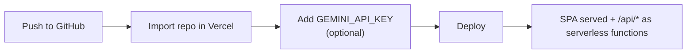

1. Push the repository to GitHub.
2. Import it at [vercel.com/new](https://vercel.com/new); the Vite framework is detected automatically.
3. Under **Environment Variables**, add `GEMINI_API_KEY` (optional).
4. Click **Deploy**. Without a key, the deployed app still runs fully on the built-in fallback.

---

## 🚧 Known Boundaries

- **Editable estimates.** All vendor pricing and category allocations are fictional starter estimates. KSHAN does not provide live vendor bidding, real-time availability or payment processing.
- **Local-first storage.** Celebrations are stored in browser IndexedDB. Clearing website data removes locally saved plans unless you exported them to JSON or CSV.
- **Single-host planning.** There is no real-time multi-user editing; plans are shared through exported JSON or printed Moment Books.

---

## 🛠 Build Process

KSHAN was built milestone by milestone using **Google Antigravity**, following the strict requirements of `KSHAN_CHATBOT_MASTER_PROMPT.md`.

For the authentic log of prompts, decisions, code splits and genuine test runs, see [`docs/ANTIGRAVITY_BUILD_LOG.md`](docs/ANTIGRAVITY_BUILD_LOG.md).

📚 More documentation: [Architecture](docs/ARCHITECTURE.md) · [Testing Report](docs/TESTING.md) · [Accessibility Audit](docs/ACCESSIBILITY.md)

---

## 📄 License

Released under the **MIT License**. See [LICENSE](LICENSE) for details.

<div align="center">

<br/>

**Made with care for the moments that matter.** 🎊


</div>
