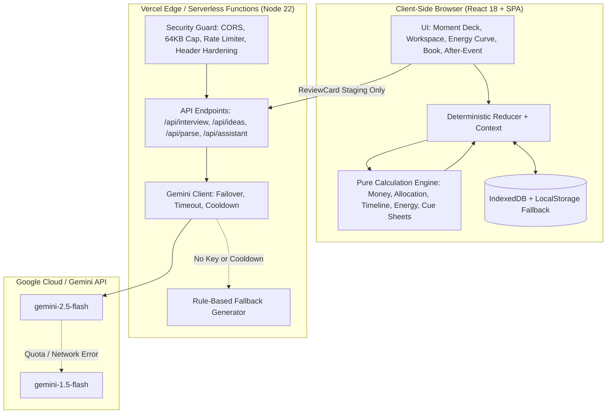

# KSHAN

> **"Budget the moments, not the vendors."**  
> A moments-first celebration planner for weddings, birthdays and community events.  
> Built for **PromptWars Virtual, Challenge 5: Celebration & Event Planner**.

[Documentation](docs/ARCHITECTURE.md) · [Testing Report](docs/TESTING.md) · [Accessibility Audit](docs/ACCESSIBILITY.md) · [Build Log](docs/ANTIGRAVITY_BUILD_LOG.md)

---

## 1. The Problem

Most event planning software treats a celebration as an accounts-payable ledger: a list of vendors, line-item invoices, and detached to-do checklists.

When money or time runs short, a vendor-centric view cannot answer the only question that matters to the host:
> *"What do our guests actually lose if we cut this?"*

Couples and families end up overspending on invisible logistical overhead while their most cherished signature moments get squeezed.

---

## 2. What KSHAN Does

KSHAN flips celebration planning on its head: **you plan and budget the 5 to 9 signature moments that define your celebration**. All costs, tasks, vendor briefs, and creative ideas attach directly to those moments.

| Challenge Requirement | How KSHAN Delivers It |
|---|---|
| **Budgets** | **Moment Budget**: Allocates money by moment importance and guest impact. Attributes shared costs (venue, sound, decor) across moments. Computes cost per moment and per guest. Protects a strict 10% contingency. Uses integer paise math with largest-remainder exact reconciliation. |
| **Timelines** | **Backwards Timeline**: Every task is tied to a moment and counted backwards from the event date. Computes dependency DAGs, detects cycles, propagates delays, and compresses lead times when the event date is imminent. |
| **Vendor Checklists** | **One-Page Cue Sheets**: Tailored printable briefs for each vendor containing only the moments they serve, exact 24h/12h start and end times, cue triggers, and contract questions. |
| **Personalised Ideas** | **Story Interview**: A 5-question host interview parsed into structured moments and 3-tier creative suggestions (modest, balanced, lavish) with integer paise estimate bands. |
| **GenAI Assistant** | **Review Card Pattern**: Gemini proposes ideas and drafts; deterministic code validates and stages them. The user explicitly reviews with **Apply**, **Edit**, or **Dismiss**. Operates seamlessly offline via built-in rule-based fallback. |
| **Weddings, Birthdays, Community Events** | **Three Built-in Templates**: Tailored starter moments, cost structures, backwards tasks, and vendor questions for each celebration occasion. |

---

## 3. Signature Features

- **The Moment Deck:** Select, sequence, and tune your celebration's signature moments. Set host importance (1–5), target energy (1–5), guest impact multipliers, and lock must-have moments.
- **Moment Budget & Trade-Off Simulator:** Simulate cutting or upgrading a moment before committing. Preview freed funds, redistributed budgets across other moments, removed tasks, and vendor impacts in real time.
- **The Energy Curve:** Visualise and balance your day's emotional arc. The curve flags awkward lulls ($> 45$ min low energy), rushed transitions ($< 15$ min high delta), unsupported peaks, or overlong high-intensity segments. Includes a fully accessible tabular equivalent.
- **Vendor Cue Sheets:** Generate clean, print-ready cue sheets per vendor so every collaborator knows their exact cue and trigger on event day.
- **The Moment Book:** A complete, printable celebration guide (`@media print` formatted) with schedule, master budget, vendor cue sheets, and backwards timeline.
- **After-Event Log:** Post-celebration reality scorecard to record actual spend, calculate net variance against planned allocations, rate moments *Keep* or *Skip*, and preserve learnings for future celebrations.

---

## 4. User Journey

```text
1. Select Celebration
   └── Choose occasion (Wedding, Birthday, Community), date, city, guests, and budget.

2. Build The Moment Deck
   └── Pick and rank moments (or run the 5-question Story Interview).

3. Inspect Plan Workspace
   └── Review the Moment Budget (cost per moment), Backwards Timeline, and Vendor Cue Sheets.

4. Test Trade-Offs
   └── Simulate cutting or upgrading moments to balance funds and eliminate feasibility gaps.

5. Print & Distribute Moment Book
   └── Export JSON/CSV and print per-vendor Cue Sheets for event-day execution.

6. After-Event Debrief
   └── Record actual spend per moment, calculate net variance, and rate moments Keep or Skip.
```

---

## 5. Technical Architecture



---

## 6. What AI Does vs. What Code Does

| AI (Language & Exploration) | Pure Deterministic Code (Ground Truth) |
|---|---|
| Parses host narrative from the 5-question Story Interview | All monetary calculations strictly in integer paise (`1 INR = 100 paise`) |
| Proposes creative ideas across 3 tiers (simple, standard, special) | Largest-remainder budget allocation guaranteeing $\sum \text{Allocated} = \text{Pool}$ |
| Extracts structured moments from raw, unstructured notes | Shared cost attribution across moments using normalised usage weights |
| Answers contextual questions about the host's celebration | Backwards timeline scheduling, DAG cycle detection, and compression |
| Stages suggestions in uncommitted `ReviewCard` components | Energy Curve transition analysis and flag triggers (`LULL`, `RUSHED`, etc.) |
| | Input validation, prototype pollution checks, and local persistence |

---

## 7. Security and Privacy

- **Zero-Storage Privacy:** Plans stay entirely in the user's browser (IndexedDB / localStorage). No remote database collects personal celebrations.
- **Serverless API Protection:** Server-side input validation, 64 KB maximum payload limit, and sliding-window rate limiting (20 req/min per IP).
- **Anti-Prompt Injection:** User-provided text is wrapped in `<USER_PROVIDED_DATA>...</USER_PROVIDED_DATA>` delimiters with strict anti-override system prompts.
- **Formula Injection Neutralization:** All CSV exports sanitize cells starting with `=`, `+`, `-`, `@`, tab, or carriage returns.
- **Prototype Pollution Prevention:** JSON plan imports strictly reject objects containing `__proto__`, `constructor`, or `prototype` keys before schema validation.
- **Hardened HTTP Headers:** Content Security Policy, `X-Content-Type-Options: nosniff`, `X-Frame-Options: DENY`, `Strict-Transport-Security`, and exact-origin CORS.

---

## 8. Genuine Test Results

All tests run locally in Node 22 via Vitest and Playwright:

```text
Vitest Unit/Integration: 16 passed, 0 failed (115 tests total, 100% pass)
Playwright E2E:          2 passed, 0 failed (Full 8-step journey + 320px responsive pass)
Automated Axe A11y:      0 WCAG 2.1 AA violations on all audited pages
Coverage (All Files):    70.28% Statements, 69.09% Branches, 50.00% Functions
Coverage (Engine):       93.27% Statements, 91.66% Branches, 96.66% Functions
Typecheck:               Clean (tsc --noEmit: 0 errors)
ESLint:                  Clean (eslint . --max-warnings 0: 0 errors, 0 warnings)
Production Build:        Vite production bundle built in 7.01s (dist: 450.45 kB JS, 26.18 kB CSS)
```

### Test Breakdown
- **Pure Engine (82 tests):** Money math (17), largest-remainder allocation (10), shared cost attribution (6), trade-off simulation (11), timeline DAG (11), energy flags (10), cue sheets (7), export-import invariants (10).
- **Storage & State (13 tests):** Reducer immutability & audit logging (6), CSV escaping & formula neutralization (7).
- **Serverless & AI (10 tests):** Security controls & delimiters (2), fallback rule-based generation & prompt structure (8).
- **UI & Export (10 tests):** Landing page, Moment Deck, Plan Workspace, Energy Curve, Moment Book print view, After-Event scorecard & variance calculation, template scaffold.
- **Playwright End-to-End (2 tests):**
  1. Full user journey: Landing $\rightarrow$ Moment Deck $\rightarrow$ Plan Workspace $\rightarrow$ Trade-off Cut $\rightarrow$ Energy Curve $\rightarrow$ Story Interview $\rightarrow$ Cue Sheets $\rightarrow$ Print Book $\rightarrow$ After-Event Log (with axe assertions at every stage).
  2. Mobile 320px responsiveness: Verifies zero horizontal scroll on body and clean stacked layout.

---

## 9. Accessibility (WCAG 2.1 Level AA)

- **Semantic Landmarks:** Single `<main id="main-content">` per page view with a visible skip-to-content link.
- **Accessible Visualizations:** The Energy Curve SVG chart is paired with a comprehensive tabular data equivalent (`Tabular Energy Equivalent`) for screen readers.
- **Color Independence:** Badges and flags communicate through semantic text, icons, and high-contrast color.
- **Contrast Ratios:** All text combinations exceed WCAG AA requirements ($> 4.5:1$ for body, $> 3:1$ for large headings).
- **320 px Responsive Layout:** Mobile viewports stack cards cleanly with zero horizontal scrollbars.
- **Keyboard Navigation:** Full tab order navigation with visible focus rings (`focus-visible:ring-2 focus-visible:ring-teal`).

---

## 10. Run Locally

```bash
# 1. Clone the repository
git clone https://github.com/vrajesh/kshan.git
cd kshan

# 2. Install dependencies
npm install

# 3. (Optional) Configure Gemini API Key
cp .env.example .env
# Edit .env and set GEMINI_API_KEY (app works 100% offline without it via built-in fallback)

# 4. Run tests, typecheck, and lint
npm test
npm run typecheck
npm run lint

# 5. Start development server
npm run dev
```

Visit `http://localhost:5173` to start planning.

---

## 11. Known Boundaries & Limitations

- **Editable Estimates:** All vendor pricing and category allocations are fictional starter estimates. KSHAN does not provide live vendor bidding, real-time availability, or payment processing.
- **Local-First Storage:** Celebrations are stored in browser `IndexedDB`. Clearing browser website data will remove locally saved plans unless exported to JSON/CSV.
- **Single-Host Planning:** There is no multi-user real-time collaborative editing; plans are shared via exported JSON or printed Moment Books.

---

## 12. Build Process & Antigravity Log

KSHAN was built milestone-by-milestone using Google Antigravity following the strict requirements of `KSHAN_CHATBOT_MASTER_PROMPT.md`.

For the authentic log of prompts, decisions, code splits, and genuine test runs, see [docs/ANTIGRAVITY_BUILD_LOG.md](docs/ANTIGRAVITY_BUILD_LOG.md).

---

## 13. License

MIT License. See [LICENSE](LICENSE) for details.
# Challenge_5

