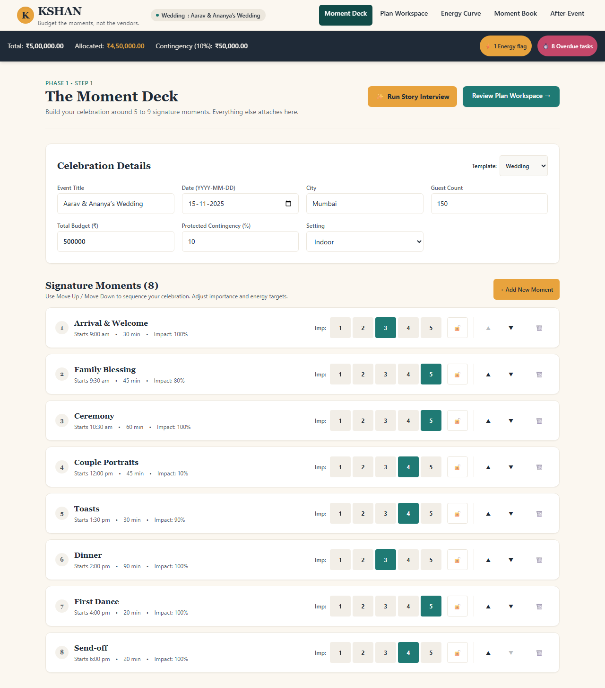
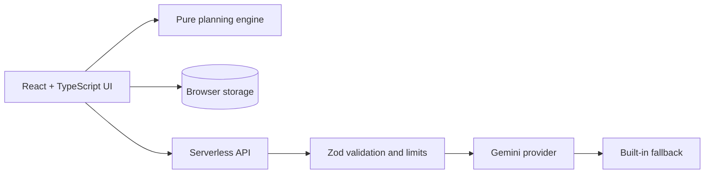

# KSHAN

> **Budget the moments, not the vendors.**
> A moments-first celebration planner for weddings, birthdays and community events.
> Built for **PromptWars Virtual, Challenge 5: Celebration & Event Planner**.

[Live app](TODO_LIVE_URL) · [Demo video](TODO_VIDEO_URL) · [Build story](TODO_POST_URL)

<!-- Add badges ONLY after the matching CI workflow exists and passes. -->


<!-- TODO: replace with a real screenshot from the deployed app -->

---

## The problem

Most planning tools split an event into categories: a budget sheet, a task list, a vendor list. But hosts do not remember categories. They remember moments: the first look, the blessing, the toast, the lantern lighting. When money or time runs short, a category view cannot answer the question that matters: *"What do we lose if we cut this?"*

## What KSHAN does

KSHAN organises the whole plan around the **5 to 9 moments** a celebration is really about. Budget, tasks, vendors and ideas all attach to those moments.

| Challenge requirement | How KSHAN delivers it |
|---|---|
| **Budgets** | Moment Budget: money allocated by moment importance, shared costs (venue, sound, decor) attributed to the moments that use them, cost per moment and per guest, a protected contingency, and exact totals |
| **Timelines** | Backwards timeline: every task is tied to a moment and counted back from the event date, with dependencies, delay propagation and automatic compression when the date is close |
| **Vendor checklists** | One-page Cue Sheets per vendor: only the moments they serve, exact timings, and questions to ask |
| **Personalised ideas** | Story Interview with Gemini: five questions about the host's story produce moments and ideas at three budget tiers |
| **GenAI assistant** | Gemini proposes; the user reviews and applies. Everything works without a key through a built-in fallback |
| **Weddings, birthdays, community events** | Three templates with their own moments, categories, tasks and vendor questions |

### Signature features

- **Moment Deck.** Pick and rank your signature moments from a template.
- **Moment Budget and trade-offs.** Cut or upgrade a moment and see the effect on budget, tasks and warnings before anything changes.
- **Energy Curve.** Set the energy you want across the day. KSHAN flags long lulls, rushed transitions and peaks with no moment behind them, and gives a text equivalent of the chart.
- **Cue Sheets.** Print-ready briefs for each vendor.
- **Moment Book.** A printable plan, plus an after-event log where you record actual spend and rate each moment *keep* or *skip*.

## User journey

1. Choose an event type, date, guest count, city and budget.
2. Pick and rank your moments (or run the Story Interview).
3. Review the Moment Budget, timeline and Cue Sheets.
4. Adjust moments and compare trade-offs.
5. Print the Moment Book and share Cue Sheets with vendors.
6. After the event, log what actually happened.

## Architecture



<!-- TODO: replace with a final diagram that matches the actual code -->

## What AI does and what code does

| Gemini (language) | Deterministic code (correctness) |
|---|---|
| Story Interview and moment suggestions | All money arithmetic (integer paise) |
| Ideas per moment at three budget tiers | Budget allocation and shared-cost attribution |
| Parsing a free-text event description | Dates, dependencies and delay propagation |
| Answering questions about your saved plan | Energy Curve checks and warnings |
| | Validating and applying every change |

Rules the AI never breaks:

- Output is validated against strict schemas; unknown fields are rejected.
- AI only **proposes**. You preview, edit or dismiss before anything is applied.
- Prices are labelled **estimates**. KSHAN never invents vendor availability or quotes.
- Your text is treated as data, not instructions.
- If Gemini is unavailable, the built-in planner answers and says so.

## Security and privacy

<!-- Only list controls that are implemented and tested. -->

- Gemini key stored only in server environment variables.
- Server-side input validation, body size limits and rate limiting.
- Security headers and a Content Security Policy; no unsafe HTML rendering.
- CSV exports neutralise formula injection; JSON imports are schema-validated.
- Plans stay in your browser. No account, and nothing about your event is stored on the server.
- Demo data is fictional.

See [SECURITY.md](SECURITY.md) to report a vulnerability.

## Accessibility

Landmarks, labelled fields, keyboard operation (including the Energy Curve, which has a table equivalent), visible focus, AA contrast, reduced-motion support, and status never shown by colour alone. Checked at 320 px width.

Automated results: `TODO: paste the real axe results`. Manual checks and known gaps: [docs/ACCESSIBILITY.md](docs/ACCESSIBILITY.md).

## Testing

```bash
npm run lint
npm run typecheck
npm test            # engine and UI tests
npm run e2e         # Playwright main journey
npm run coverage
```

Results from the latest run: `TODO: paste actual counts and coverage`.

The engine tests cover: money always sums exactly, locked lines never change, dependency cycles are rejected, trade-off previews never mutate the plan, and malicious pasted text is treated as data.

## Run locally

```bash
git clone TODO_REPO_URL
cd kshan
npm install
cp .env.example .env     # optional: add GEMINI_API_KEY
npm run dev
```

KSHAN works fully without a Gemini key. Set `GEMINI_MODELS` in `.env` to choose the models.

## Deployment

See [docs/DEPLOYMENT.md](docs/DEPLOYMENT.md). Secrets go in the hosting environment, never in the repository.

## Known limits

- Prices and vendor categories are **editable estimates**, not quotations.
- No live vendor availability, payments or bookings.
- No accounts or real-time collaboration; plans live in your browser.
- TODO: add anything untested or unfinished.

## How this was built

Built with Google Antigravity. Real prompts, iterations and decisions are in [docs/ANTIGRAVITY_BUILD_LOG.md](docs/ANTIGRAVITY_BUILD_LOG.md).

## Licence

MIT. See [LICENSE](LICENSE).
