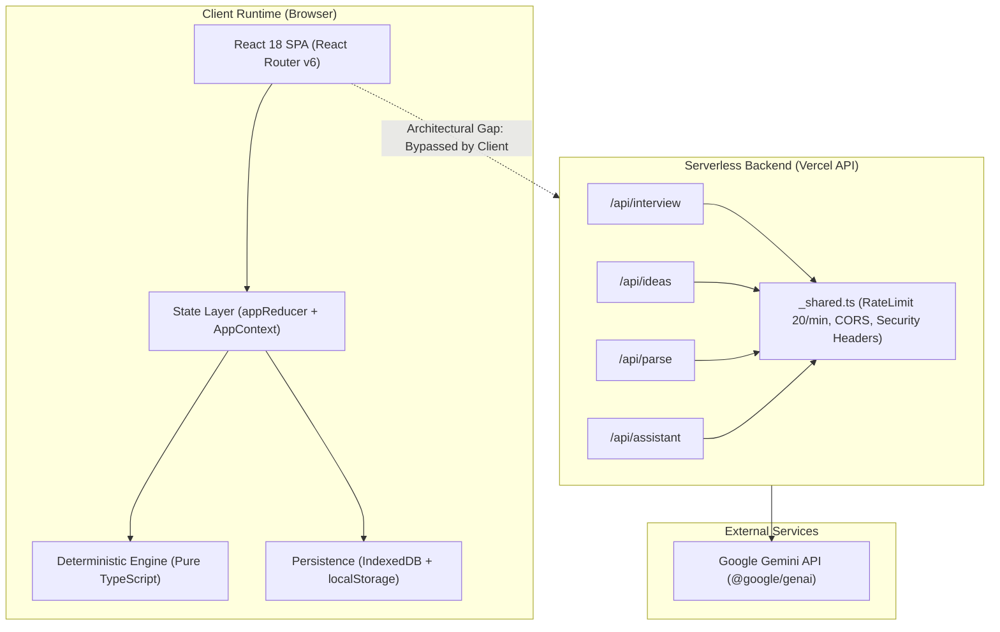

# KSHAN — Architecture Audit Report
**Document ID:** `AUDIT-01-ARCH`  
**Auditor:** Code Quality & Architecture Auditor / Lead Auditor  
**Date:** 01 November 2026  
**Status:** COMPLETE (VERIFIED)  

---

## 1. Executive Summary

This architecture audit evaluated the structural soundness, modularity, state management, client/server boundaries, and persistence layer of **KSHAN** ("Budget the moments, not the vendors").

Overall, the core domain architecture is **exceptionally well-designed**:
1. **Mathematical Core:** The domain calculations (`allocation.ts`, `money.ts`, `tradeoff.ts`, `timeline.ts`, `energy.ts`, `attribution.ts`, `cuesheet.ts`) are **100% pure functions** with zero side-effects, zero I/O, and strict immutability.
2. **State Pattern:** Single unidirectional state flow via React Context + `useReducer` (`reducer.ts`, `context.tsx`). No third-party state bloat (Redux/Zustand).
3. **Storage:** Clean local-first persistence with IndexedDB primary and localStorage fallback (`storage.ts`).

However, the audit uncovered **two significant architectural issues**:
- **Critical Client/Server Boundary Leak:** The frontend directly imports `runInterview` from `src/ai/client.ts` in `StoryInterviewModal.tsx`. Because `client.ts` imports `@google/genai` (a server-side SDK), the entire Google GenAI SDK and its Node dependencies are bundled into the client-side JavaScript asset (`dist/assets/index-CCNw2ZyA.js` = 488.16 kB). Furthermore, the client cannot read server-side `process.env.GEMINI_API_KEY`, causing client-side AI calls to immediately failover to fallback without contacting the dedicated serverless endpoints in `api/`.
- **Monolithic Page Components:** `PlanWorkspacePage.tsx` (911 lines) and `MomentDeckPage.tsx` (610 lines) bundle complex forms, modal states, metric calculations, and tables into single component trees without submodule decomposition.

---

## 2. High-Level Architecture Map



---

## 3. Detailed Component & Subsystem Analysis

### 3.1 Pure Mathematical Domain Engines (`src/engine/`)
- **Status:** `VERIFIED` — Excellent
- **Evidence:**
  - `src/engine/money.ts`: Implements strict integer-paise math ($1\text{ INR} = 100\text{ paise}$). Never uses floating-point values for monetary storage or allocation. Functions `addPaise`, `subPaise`, `safeDivide`, `parseINR`, `formatINR` assert `Number.isInteger()`.
  - `src/engine/allocation.ts`: Employs the **largest-remainder method (Hamilton-Hare algorithm)**. Guarantees that the sum of allocated minor amounts equals the usable budget pool down to the exact paisa:
    $$\sum_{i=1}^n \text{allocatedMinor}_i = \text{remainingMinor}$$
    If locked cost lines exceed the usable budget, it safely returns a structured `feasibilityGap` rather than throwing or producing negative numbers.
  - `src/engine/tradeoff.ts`: Pure preview functions (`cutMoment`, `upgradeMoment`). Deep-freezes input plan state in tests and returns before/after comparisons, freed amounts, affected tasks, and affected vendor categories.
  - `src/engine/timeline.ts`: Directed Acyclic Graph (DAG) topological sorting with cycle detection (`detectCycle`). Automatically compresses lead times if the event date is closer than required and records human-readable `compressionNote`.
  - `src/engine/energy.ts`: Diagnostic engine that flags emotional pacing risks (`LULL`, `RUSHED`, `UNSUPPORTED_PEAK`, `OVERLONG`) and generates an accessible plaintext table representation for screen readers.

### 3.2 State Architecture (`src/state/`)
- **Status:** `VERIFIED` — Strong
- **Evidence:**
  - `reducer.ts`: Pure reducer with 24 strongly typed action types. Every plan mutation generates an `AuditEntry` (`plan.audit`) timestamped with action details.
  - `context.tsx`: Provides `useAppContext()` with clear dispatch hooks.
  - **Trade-off/Finding:** The entire `plan` object is stored in a single state container. When typing in an input field (e.g. updating an expense or task title), the entire `plan` state updates, causing sub-components across the page to re-render. Memoization (`useMemo`) is used heavily in `PlanWorkspacePage.tsx` to mitigate this, but decomposing plan state into domain slices or memoizing sub-components (`React.memo`) would improve rendering efficiency.

### 3.3 Client/Server Boundary Violation (`src/ui/` vs `api/` vs `src/ai/`)
- **Status:** `BROKEN` / `ARCHITECTURAL LEAK`
- **Issue ID:** `ARCH-01`
- **Location:** `src/ui/components/StoryInterviewModal.tsx:11`, `src/ai/client.ts:11`
- **Problem:**
  `StoryInterviewModal.tsx` contains:
  ```typescript
  import { runInterview } from '../../ai/client';
  ```
  And `src/ai/client.ts` contains:
  ```typescript
  import { GoogleGenAI } from '@google/genai';
  ```
  `client.ts` was intended as a server-side helper for the Vercel functions (`api/interview.ts`), but because it is directly imported into a React component:
  1. Vite bundles `@google/genai` directly into the client-side bundle.
  2. The browser cannot access server environment variables (`process.env.GEMINI_API_KEY`), so `callGeminiWithFailover` evaluates `apiKey` as `undefined` and always fails over to `generateFallbackInterview()`.
  3. The `/api/interview` serverless route (which has access to the server's `.env`) is never invoked.
- **Architectural Fix:**
  Create a client-side API transport function `src/lib/api-client.ts`:
  ```typescript
  export async function fetchInterview(data: InterviewAnswers): Promise<InterviewResult> {
    const res = await fetch('/api/interview', {
      method: 'POST',
      headers: { 'Content-Type': 'application/json' },
      body: JSON.stringify(data),
    });
    if (!res.ok) throw new Error('API request failed');
    return res.json();
  }
  ```
  Update `StoryInterviewModal.tsx` to call `fetchInterview()`, falling back to `generateFallbackInterview()` only if the network request fails.

### 3.4 Missing Route Code-Splitting
- **Status:** `VERIFIED` — Moderate Inefficiency
- **Issue ID:** `ARCH-02`
- **Location:** `src/App.tsx:10-16`
- **Problem:**
  All six route pages (`LandingPage`, `MomentDeckPage`, `PlanWorkspacePage`, `VendorMarketplacePage`, `EnergyCurvePage`, `MomentBookPage`, `AfterEventPage`) are imported statically:
  ```typescript
  import { LandingPage } from './ui/pages/LandingPage';
  import { MomentDeckPage } from './ui/pages/MomentDeckPage';
  // ...
  ```
  This causes Vite to bundle all pages into a single 488.16 kB JavaScript chunk. Users visiting the landing page must download the entire vendor marketplace, print book, and chart code before first render.
- **Architectural Fix:**
  Use `React.lazy()` and `Suspense`:
  ```typescript
  const LandingPage = lazy(() => import('./ui/pages/LandingPage').then(m => ({ default: m.LandingPage })));
  const PlanWorkspacePage = lazy(() => import('./ui/pages/PlanWorkspacePage').then(m => ({ default: m.PlanWorkspacePage })));
  ```

---

## 4. Architecture Quality Metrics

| Dimension | Rating (1-10) | Evaluation |
|---|---|---|
| **Separation of Concerns** | 8.5 / 10 | Domain logic is cleanly separated from presentation; UI contains some inline business calculations. |
| **Data Integrity & Immutability** | 9.8 / 10 | Immutability strictly enforced; integer-paise math eliminates arithmetic drift. |
| **Client/Server Boundary** | 5.0 / 10 | Server SDK bundled in client; API endpoints bypassed by frontend. |
| **Modularity & Reusability** | 7.5 / 10 | Engine modules are pristine; workspace page components are oversized (>900 lines). |
| **Resilience & Fault Tolerance** | 9.5 / 10 | Graceful offline fallback in place across all features. |
| **Overall Architecture Score** | **8.1 / 10** | Strong foundation with clear targeted fixes needed at the API boundary. |
