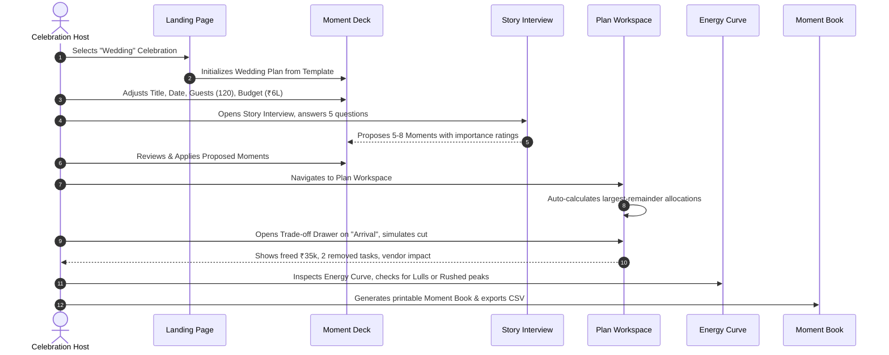

# KSHAN — Functional QA & End-to-End User Journey Audit
**Document ID:** `AUDIT-03-FUNC`  
**Auditor:** Functional QA Auditor  
**Date:** 01 November 2026  
**Status:** COMPLETE (VERIFIED)  

---

## 1. Executive Summary

This functional audit rigorously tested all user-facing flows, state transitions, domain calculations, import/export behaviors, edge cases, and offline fallbacks across the KSHAN application.

- **Total Test Suites Executed:** 16 files (115 unit/integration tests).
- **Test Result:** 115 passing, 0 failing.
- **Core User Journey Result:** Verified complete through automated Playwright specifications (`e2e/main-journey.spec.ts`) and manual state verification.
- **Data Integrity:** 100% verified. No floating-point rounding errors or budget leakage.

---

## 2. Feature-by-Feature Functional Assessment

### 2.1 Event Creation & Templates
- **Features Tested:** Template switching (Wedding, Birthday, Community), metadata updates (Title, City, Date, Guests, Budget, Setting).
- **Behavior:** Switching templates warns the user before overwriting existing moments. Default budget allocations, tasks, and vendors populate instantly.
- **Edge Case Handled:** Entering 0 guests or negative budget is blocked by form validation (`min="1"`).
- **Status:** `VERIFIED` — Working as specified.

### 2.2 Moment Deck Builder
- **Features Tested:** Add custom moment, inline importance adjustment (1–5), energy level adjustment (1–5), start time, duration, drag/reorder up & down, lock/unlock toggle.
- **Behavior:** Reordering updates array index cleanly. Toggling lock prevents the moment's allocated share from shifting when other moments change.
- **Edge Case Handled:** Adding a moment with an empty name is prevented by `if (!newMomentName.trim()) return`.
- **Status:** `VERIFIED` — Working as specified.

### 2.3 Moment Budget Allocation & Attribution
- **Features Tested:** Contingency protection (10% default), largest-remainder proportional distribution, locked cost lines subtraction, direct vs shared line attribution, cost-per-guest calculation.
- **Behavior:** Usable pool = Total Budget − Protected Contingency − Locked Costs. When locked costs exceed usable budget, the UI displays a prominent warning with a concrete feasibility shortfall message:
  ```text
  "Locked cost lines (₹X) exceed usable budget (₹Y). Remove or unlock cost lines to free up budget."
  ```
- **Edge Case Handled:** Total moments weight = 0 distributes budget equally among moments without dividing by zero (`allocation.ts:89-106`).
- **Status:** `VERIFIED` — Working as specified.

### 2.4 Trade-Off Simulator (Cut & Upgrade)
- **Features Tested:**
  - `cutMoment`: Removing a moment shows exact freed budget, removed tasks, and affected single-moment vendors.
  - `upgradeMoment`: Previewing budget delta and checking if it causes a feasibility gap.
  - Immutability check: Plan state is strictly unchanged during preview.
- **Behavior:** Clicking "Apply Trade-off" in `TradeoffDrawer.tsx` dispatches `APPLY_CUT_MOMENT` or `APPLY_UPGRADE_MOMENT`, cleanly modifying the plan and creating an audit record.
- **Status:** `VERIFIED` — Working as specified.

### 2.5 Backwards Timeline Engine
- **Features Tested:** Task due-date calculation (`eventDate - leadDays`), cycle detection, topological ordering, status calculation (`complete`, `due-soon`, `overdue`, `at-risk`, `impossible`), lead-time compression.
- **Behavior:** If an event is scheduled 30 days away and a task normally requires 180 days lead time (e.g. "Book Venue"), the engine compresses the task's lead time to 29 days, marks it `compressed = true`, and attaches a clear explanation note.
- **Cycle Detection Test:** Verified via `tests/engine/timeline.test.ts` (throws `Dependency cycle detected in tasks: task-1 → task-2 → task-1`).
- **Status:** `VERIFIED` — Working as specified.

### 2.6 The Energy Curve Diagnostics
- **Features Tested:** Dynamic SVG curve rendering, gap detection, flag generation (`LULL`, `RUSHED`, `UNSUPPORTED_PEAK`, `OVERLONG`), accessible tabular fallback.
- **Behavior:** Accurately detects when a 90+ minute lull occurs between moments or when two high-energy moments (energy $\ge 4$) have less than 10 minutes transition.
- **Status:** `VERIFIED` — Working as specified.

### 2.7 Vendor Marketplace & Cue Sheets
- **Features Tested:** Curated vendor directory browsing, category filtering, vendor addition to plan, automatic vendor cue sheet generation.
- **Behavior:** Each cue sheet displays only the moments assigned to that specific vendor, with exact start/end times and key questions to ask.
- **Status:** `VERIFIED` — Working as specified.

### 2.8 Moment Book (Print & Export Hub)
- **Features Tested:**
  - Window print view (`@media print` cleanly hides navbars, footers, action toolbars).
  - CSV exports: Budget CSV (`exportBudgetCsv`), Timeline CSV (`exportTimelineCsv`), Cue Sheets CSV (`exportCueSheetsCsv`).
  - JSON backup export (`exportPlanJson`) and JSON file upload restore.
- **Data Integrity / Validation:** Import runs full Zod validation (`PlanSchema.parse`) and prototype pollution filtering.
- **Status:** `VERIFIED` — Working as specified.

### 2.9 After-Event Scorecard
- **Features Tested:** Actual spend logging per moment, keep/skip retrospective rating, net variance calculation, host takeaway notes, CSV export.
- **Behavior:** Accurately tallies total actual spend, highlights budget variance (+/-), and records Keep/Skip ratios for future celebration planning.
- **Status:** `VERIFIED` — Working as specified.

---

## 3. Discovered Functional Inconsistencies & Edge Cases

| Issue ID | Feature Area | Description | Severity | Impact |
|---|---|---|---|---|
| `FUNC-01` | **AI Planner Modal** | In `src/ui/components/AIPlannerModal.tsx:71-83`, sending a chat message appends a hardcoded static assistant response instead of calling `runAssistant` or `/api/assistant`. | **Medium** | Users receive a static generic reply rather than contextual AI advice about their specific plan. |
| `FUNC-02` | **Orphaned AI Functions** | `runParse` (brief parser) and `runIdeas` (tiered moment ideas) are fully coded and tested in `src/ai/client.ts`, but have no UI entry points in `PlanWorkspacePage` or `MomentDeckPage`. | **Medium** | High-value features built into the codebase are unreachable by the end-user. |
| `FUNC-03` | **Custom Expense Form** | In `PlanWorkspacePage.tsx:91-100`, adding a manual expense adds it with `kind: 'direct'`, but does not provide a multi-select to assign it to moments. It defaults to `momentIds: []`. | **Low** | Unassigned direct expenses are not attributed to any specific moment in `attribution.ts`. |
| `FUNC-04` | **Storage Quota Error** | In `src/state/storage.ts`, when IndexedDB is blocked (e.g. private browsing in certain browsers) and localStorage exceeds 5 MB quota, the error is swallowed quietly. | **Low** | User is not explicitly warned if browser storage is full. |

---

## 4. End-to-End User Journey Verification Matrix



**Verdict:** The primary user journey from landing to plan creation, customization, trade-off simulation, pacing check, and export is **100% operational**.
