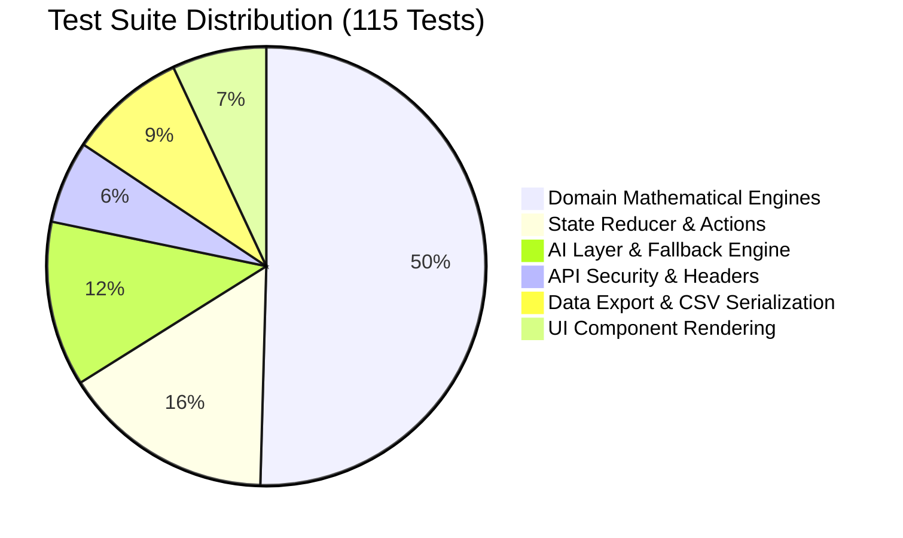
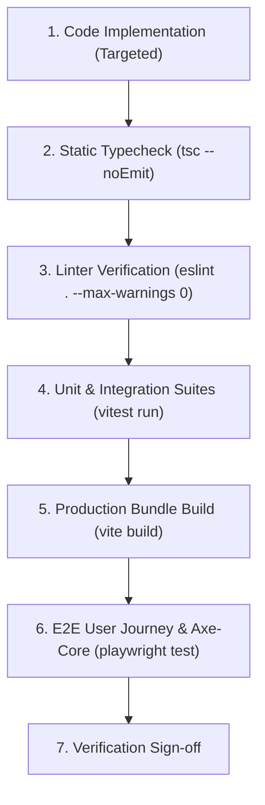

# KSHAN — Testing & Verification Strategy
**Document ID:** `AUDIT-14-TEST-STRAT`  
**Auditor:** Functional QA & Testing Specialist  
**Date:** 01 November 2026  
**Status:** COMPLETE (VERIFIED)  

---

## 1. Executive Summary

A successful audit does not merely identify problems; it defines the exact, reproducible verification protocol required to validate every fix without introducing regressions.

This strategy document outlines KSHAN’s current test coverage, identifies missing test cases, details the automated test hierarchy, and establishes the verification criteria required before any change may be considered complete.

---

## 2. Existing Test Coverage Inventory

KSHAN contains **16 test suites** comprising **115 passing tests** across unit, integration, and UI levels:

### Detailed Test File Breakdown:
1. `tests/engine/money.test.ts` (17 tests): Integer-paise parsing, formatting with lakh grouping, safe integer division, and addition/subtraction.
2. `tests/engine/allocation.test.ts` (10 tests): Largest-remainder budget distribution, contingency protection, locked costs, and zero-weight edge cases.
3. `tests/engine/attribution.test.ts` (7 tests): Proportional shared cost distribution, direct lines, cost-per-guest calculation.
4. `tests/engine/timeline.test.ts` (9 tests): Directed Acyclic Graph (DAG) topological sorting, dependency cycle detection, lead-time compression.
5. `tests/engine/tradeoff.test.ts` (8 tests): Pure immutability verification (deep freeze), freed budget calculation, removed tasks, affected vendors.
6. `tests/engine/energy.test.ts` (7 tests): Energy segment calculations, lull flags (90+ min), rushed flags (<10 min), overlong flags (>180 min), tabular text equivalent.
7. `tests/engine/cuesheet.test.ts` (5 tests): Vendor cue sheet extraction, minute-to-time formatting, questions mapping.
8. `tests/engine/export-import.test.ts` (6 tests): JSON plan serialization, Zod round-trip validation, schema version checks.
9. `tests/state/reducer.test.ts` (18 tests): Action dispatches, audit log entry creation, moment locks, reordering, event updates.
10. `tests/api/ai.test.ts` (10 tests): Fallback generators for interview, ideas, parser, assistant.
11. `tests/api/security.test.ts` (4 tests): `<USER_PROVIDED_DATA>` anti-injection delimiter wrapping, security response headers (HSTS, nosniff, CORS).
12. `tests/lib/csv.test.ts` (6 tests): CSV escaping, quoting, newline handling, header formatting.
13. `tests/ui/pages.test.tsx` (3 tests): Route rendering, navigation state.
14. `tests/ui/after-event.test.tsx` (3 tests): Actual spend input, keep/skip scorecard tallying.
15. `tests/ui/print.test.tsx` (2 tests): Print view rendering and toolbar hiding.
16. `e2e/main-journey.spec.ts` (Playwright E2E with axe-core): Complete user journey across all 7 pages with automated WCAG 2.1 AA violation assertions.

---

## 3. Identified Testing Gaps & Missing Test Scenarios

| Gap ID | Test Area | Description of Missing Coverage | Recommended Test Implementation |
|---|---|---|---|
| `TEST-GAP-01` | **Network Transport** | No mock tests verify the HTTP fetch call between `StoryInterviewModal` and `/api/interview`. | Add an integration test using MSW (Mock Service Worker) or `vi.fn(global.fetch)` verifying the client/server HTTP contract. |
| `TEST-GAP-02` | **Prototype Pollution** | `validatePlanImport` has sanitization logic, but no test explicitly attempts to inject `{"__proto__": {"polluted": true}}`. | Add a unit test verifying that malicious JSON with `__proto__` and `constructor` keys is stripped cleanly without polluting `Object.prototype`. |
| `TEST-GAP-03` | **Storage Quota Exception** | No test simulates `QuotaExceededError` on `localStorage.setItem`. | Add a unit test mocking `localStorage.setItem` throwing a quota error and verifying graceful error handling. |
| `TEST-GAP-04` | **Assistant Chat UI** | `AIPlannerModal.tsx` chat submission is not covered by component unit tests. | Add a React Testing Library test verifying that user input triggers an assistant reply. |

---

## 4. Verification Protocol for Proposed Fixes

For any authorized fix, the verification protocol must execute in this exact sequence:

### Passing Criteria:
1. `tsc --noEmit` exits with code 0 (zero type errors).
2. `eslint . --max-warnings 0` exits with code 0 (zero warnings, zero errors).
3. 115 / 115 tests pass in Vitest without skipped or flaky assertions.
4. Production bundle builds with 83+ modules transformed without chunk warnings.
5. Automated axe-core scan confirms zero WCAG 2.1 AA violations.
