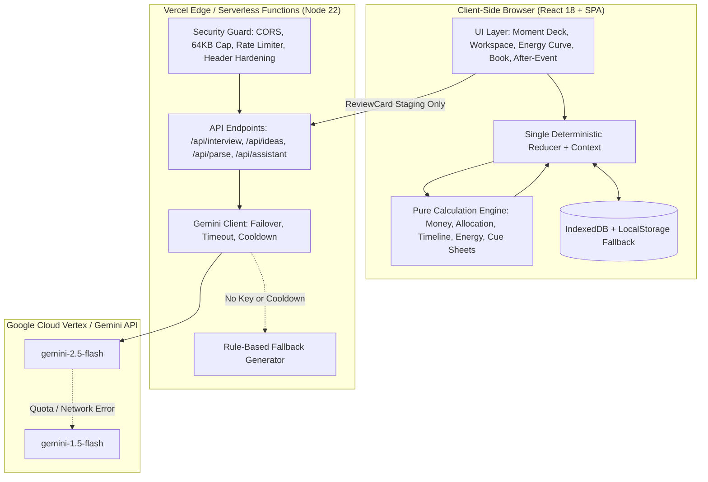

# KSHAN — Technical Architecture

> **"Budget the moments, not the vendors."**

KSHAN is a client-first, privacy-grounded celebration and event planning application built for PromptWars Virtual (Challenge 5: Celebration & Event Planner).

---

## 1. System Overview

---

## 2. Core Architectural Pillars

### 2.1 The Code vs. AI Boundary
- **Code owns ground truth:** All money arithmetic, budget distributions, constraint checks, dependency DAG traversals, energy curve flagging, and cue sheet generations are computed by 100% deterministic, side-effect-free pure functions.
- **AI only suggests language:** Gemini proposes creative moment ideas, natural language interpretations, and draft schedules. It can never directly mutate plans, alter money values, or bypass validation.
- **Review Card Pattern:** Every AI suggestion must be surfaced in an explicit Review Card with an honest disclosure pill (`"Suggested by Gemini"` vs `"Generated by the built-in planner"`) where the user decides whether to **Apply**, **Edit**, or **Dismiss**.

### 2.2 Financial Invariant: Integer Paise Arithmetic
- To avoid IEEE 754 floating-point rounding drift (e.g., `0.1 + 0.2 !== 0.3`), all currency is parsed, stored, and calculated strictly in integer paise (`1 INR = 100 paise`).
- Allocation across moments utilizes the **largest-remainder method (Hamilton-Hare method)**:
  $$\sum \text{Allocated Paise} = \text{Remaining Usable Pool}$$
  Every single rupee is accounted for without rounding leakage.

### 2.3 Local-First Privacy
- Plans stay entirely within the user's browser.
- No user accounts, passwords, or remote relational databases.
- Storage uses `IndexedDB` with automatic fallback to `localStorage`.
- All JSON imports pass strict prototype pollution checks (rejection of `__proto__`, `constructor`, `prototype`) and Zod schema validation.

### 2.4 Backwards Timeline Engine
- Calculates deadlines backwards from the event date using task lead times:
  $$\text{DueDate} = \text{EventDate} - \text{LeadDays}$$
- Builds a dependency directed acyclic graph (DAG). Uses depth-first cycle detection to reject recursive circular dependencies.
- Handles imminent events gracefully: tasks with $\le 365$ days of lead time are compressed down to the available window with an explicit human-readable note; tasks requiring $> 365$ days are marked `impossible`.

### 2.5 Vendor Cue Sheets & Energy Arc
- Every vendor receives a tailored cue sheet filtering only the moments they serve, complete with exact start/end times, energy ratings, specific cues, and contract deadlines.
- The Energy Curve evaluates transition gaps between consecutive moments, flagging lulls ($> 45$ min low energy), rushed transitions ($< 15$ min high delta), unsupported peaks, or overlong high-intensity segments.
